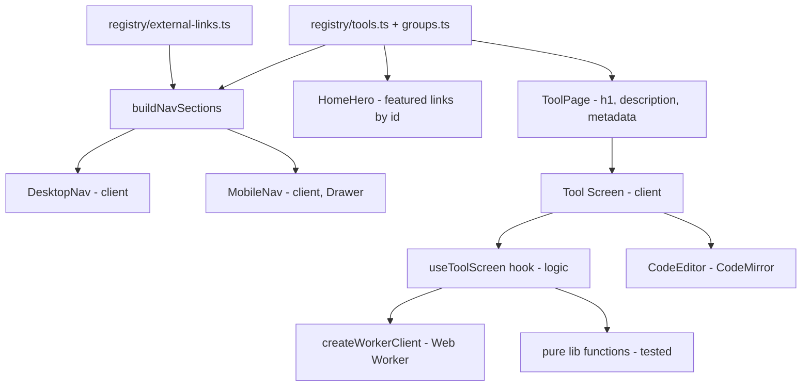

# App Shell Design

**Spec**: `.specs/features/app-shell/spec.md`
**Status**: Approved (user approved moving to design + implementation on 2026-11-12)

---

## Architecture Overview

Pages are Server Components that only compose. Interactivity lives in small
`'use client'` leaves (navigation, editors, tool screens). A single registry is
the source of truth for routes, menus, home featured links and page metadata.



### Folder structure

```
src/
  app/                      # routes only (Server Components)
    layout.tsx              # html/body, AppProviders, SkipNav, AppHeader
    page.tsx                # Home
    not-found.tsx
    beautify/json/page.tsx  # one file per tool route, ~10 lines each
    ...
  theme/system.ts           # Chakra createSystem: tokens + semantic tokens + globalCss
  registry/                 # tools, groups, external links, selectors
  components/
    providers/              # AppProviders ('use client')
    navigation/             # AppHeader, DesktopNav, NavFlyout, MobileNav, useFlyoutNav
    home/                   # HomeHero
    tool/                   # ToolPage, ToolPanel, ToolToolbar, StatusMessage, CopyButton
    editor/                 # CodeEditor, editorTheme
  features/<tool>/          # lib (pure), worker, screen components, screen hooks
  lib/                      # worker client, debounce hook, clipboard hook, text position
```

---

## Components

### Tool registry (SHELL-01)

- **Location**: `src/registry/`
- **Interfaces**:
  - `toolGroups: readonly ToolGroup[]` — ordered Beautify, Validation, Transformations, Helpers
  - `tools: readonly ToolDefinition[]`
  - `externalLinks: readonly ExternalLink[]`
  - `getTool(id: ToolId): ToolDefinition`
  - `getToolsByGroup(groupId): ToolDefinition[]`
  - `buildNavSections(groups, tools, links): NavSection[]` — pure; drops empty groups

### Navigation (SHELL-02, SHELL-03, SHELL-04)

- **Pattern**: WAI-ARIA *Disclosure Navigation Menu* (site navigation, not `role="menu"`):
  `<nav aria-label="Main"><ul><li><button aria-expanded aria-controls>` + panel `<ul>` of links.
- **`useFlyoutNav`** (hook): `openId`, `open(id)`, `close()`, hover handlers with a 150ms
  close delay, `onTriggerKeyDown` (ArrowDown opens + focuses first link), `onPanelKeyDown`
  (ArrowUp/Down/Home/End move focus, Escape closes + focuses trigger), `onItemBlur`
  (closes when focus leaves the item).
- **`NavFlyout`**: renders one section (tool group or "Links"); external items render
  `target="_blank" rel="noopener noreferrer"`, an icon and a visually hidden "(opens in a new tab)".
- **`MobileNav`**: Chakra `Drawer` opened by an icon button below `md`; sections as headings + lists.
- **Active state**: `usePathname()` → `aria-current="page"` on item and `data-active` on trigger.
- **No-JS fallback**: `<noscript>` style reveals panels on `:hover`/`:focus-within`.
- **Reduced motion**: panel animation only under `_motionSafe`.

### Home (SHELL-05, SHELL-10)

- `HomeHero` (Server Component): single `h1` "Kanivete", tagline with green highlight,
  two featured links resolved with `getTool('json-beautify')` / `getTool('xml-to-xsd')`.
  Hero surface uses brand blue `#0131CD`; CTAs green with navy text.

### Tool layout (SHELL-06)

- `ToolPage({ toolId, children })` (Server): `h1` + description from registry.
- `buildToolMetadata(toolId): Metadata` for `generateMetadata`-free static `metadata` exports.
- `ToolPanels` — responsive grid: side by side ≥ `lg`, stacked below.
- `ToolToolbar` — flex wrap slot for options/actions.
- `StatusMessage({ status: 'success' | 'error' | 'warning' | 'info', ... })` — `role="alert"` for
  errors, `role="status"` otherwise.
- `CopyButton({ value })` — uses `useCopyToClipboard`, announces "Copied" via `aria-live`.

### Editor (SHELL-07)

- `CodeEditor` (`'use client'`): wraps `@uiw/react-codemirror`.
  - Props: `value`, `onChange?`, `language: 'json' | 'jsx' | 'tsx' | 'xml'`, `readOnly?`,
    `label` (aria-label), `diagnostics?: EditorDiagnostic[]`, `ref?: Ref<CodeEditorHandle>`.
  - `CodeEditorHandle.focusAt(offset)` — moves cursor + scrolls (used by "go to error").
  - `indentWithTab={false}` to avoid keyboard traps (WCAG 2.1.2).
  - Diagnostics pushed with `setDiagnostics` from `@codemirror/lint`.
- `editorTheme` — `createTheme` from `@uiw/codemirror-themes` using Chakra CSS variables
  (`var(--chakra-colors-…)`) so tokens are not duplicated.

### Theme (SHELL-08, SHELL-11)

- `src/theme/system.ts`: `createSystem(defaultConfig, defineConfig({...}))`.
  - Tokens: `brand.blue #0131CD`, `brand.green #B9FC01`, `brand.white #FFFFFF`, `navy.*` scale.
  - Semantic tokens (dark only, same value for base and `_dark`): `bg`, `bg.panel`, `bg.subtle`,
    `bg.muted`, `fg`, `fg.muted`, `border`, palettes `accent` (green, contrast navy) and
    `brand` (blue, contrast white); `gray.focusRing` / `accent.focusRing` → green.
  - `globalCss`: `*:focus-visible` green outline fallback for native elements.
- `<html className="dark">` so Chakra component recipes resolve their dark values.

---

## Data Models

```ts
type ToolGroupId = 'beautify' | 'validation' | 'transformations' | 'helpers';
type ToolId =
  | 'json-beautify' | 'jsx-beautify' | 'json-validation'
  | 'xml-validation' | 'xml-to-xsd' | 'connection-string';

interface ToolGroup { id: ToolGroupId; label: string }
interface ToolDefinition {
  id: ToolId; name: string; shortName: string; description: string;
  groupId: ToolGroupId; href: `/${string}`;
}
interface ExternalLink { id: string; name: string; href: string; description: string }

interface NavItem { id: string; label: string; description: string; href: string; external: boolean }
interface NavSection { id: string; label: string; items: NavItem[] }
```

---

## Shared libraries

| Module | Interface | Purpose |
| --- | --- | --- |
| `lib/worker/createWorkerClient.ts` | `createWorkerClient<Req, Res>(factory, { timeoutMs })` → `{ run(req): Promise<Res>; dispose() }` | Request ids, timeout → terminate + lazy recreate (JSX-06) |
| `lib/worker/exposeWorkerHandler.ts` | `exposeWorkerHandler(handler)` | Worker-side protocol (`{ id, payload }` → `{ id, ok, result \| error }`) |
| `lib/useLatestTask.ts` | `useLatestTask(task)` | Runs async tasks, discards stale results (latest-wins), tracks `isPending` |
| `lib/useDebouncedValue.ts` | `useDebouncedValue(value, ms)` | 300ms debounce for typing |
| `lib/useCopyToClipboard.ts` | `{ copy, status }` | Clipboard + error when unavailable |
| `lib/textPosition.ts` | `offsetToLineColumn`, `lineColumnToOffset` | Shared by JSON/XML/JSX error positions |
| `lib/downloadText.ts` | `downloadText(name, text, mime)` | Blob download (XSD-07) |

---

## Error Handling Strategy

| Scenario | Handling | User impact |
| --- | --- | --- |
| Clipboard unavailable/denied | `useCopyToClipboard` returns `status: 'error'` | "Copy failed — select and copy manually" alert |
| Worker crash / timeout | client rejects, terminates, recreates on next run | Error alert; next keystroke retries |
| Unknown route | `app/not-found.tsx` | 404 with link home |

---

## Tech Decisions

| Decision | Choice | Rationale |
| --- | --- | --- |
| Flyout primitive | Custom disclosure nav (no Chakra `Menu`) | `Menu` is an *action* menu (click to open, `role="menu"`); disclosure is the WAI-ARIA pattern for site nav and supports hover cleanly |
| Next config | `output: 'export'`, no `cacheComponents` | Cache Components requires the Node.js runtime; static export has no server |
| Dark mode | `className="dark"` on `<html>`, no `next-themes` | Dark-only v1 (YAGNI) |
| XML libs | `fast-xml-validator` + `fast-xml-builder` + `fast-xml-parser` | `XMLValidator`/`XMLBuilder` in `fast-xml-parser` v5 are deprecated in favor of these packages |
| JSON parsing | Own position-aware parser (`features/json/lib`) | Needs exact line/col across browsers, big-number preservation (JSON-06), duplicate-key warnings (JSON-08) and key sorting — `JSON.parse` cannot do these |
| Icons | `lucide-react` | Tree-shakeable, accessible SVGs |
| Tests | Vitest + Testing Library (jsdom) | Pure libs unit-tested; nav/registry component-tested |
