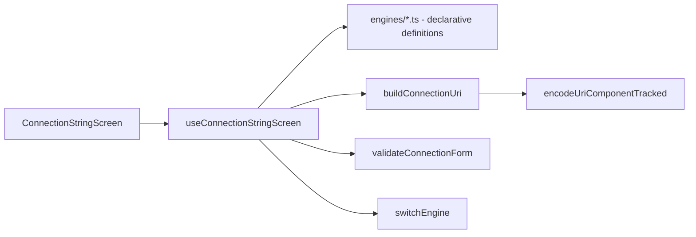

# Connection String Builder Design

**Spec**: `.specs/features/connection-string-builder/spec.md`
**Status**: Approved

## Architecture



All logic is pure and synchronous (tiny inputs) — no worker.

## Data Models

```ts
type EngineId = 'postgresql' | 'mysql' | 'mongodb' | 'redis' | 'oracle' | 'clickhouse' | 'sqlserver';

interface EngineVariant {          // SRV / TLS / Secure toggle
  label: string;                   // e.g. 'SRV', 'TLS', 'Secure'
  scheme: string;
  defaultPort: number | null;      // null = no port (mongodb+srv)
  impliedParams?: Record<string, string>;   // clickhouse secure=true
  singleHost?: boolean;            // mongodb+srv
}

interface EngineDefinition {
  id: EngineId; label: string;
  scheme: string; defaultPort: number;
  variant?: EngineVariant;
  credentials: 'userinfo' | 'none' | 'password-only-allowed';
  multipleHosts: boolean;
  database: { label: string; placement: 'path' | 'query'; queryKey?: string; numeric?: boolean };
  supportsInstance: boolean;       // sqlserver
  suggestedParams: ParamSuggestion[];
  notice?: string;                 // oracle credentials notice
}

interface ParamSuggestion {
  key: string; description: string; values?: string[]; driverSpecific?: boolean;
}

interface ConnectionForm {
  engineId: EngineId; variantEnabled: boolean;
  hosts: { id: string; host: string; port: string }[];
  username: string; password: string; database: string; instance: string;
  params: { id: string; key: string; value: string; origin: 'suggested' | 'custom' }[];
}

interface BuildResult {
  uri: string; maskedUri: string;
  encodings: { field: string; changes: { char: string; encoded: string }[]; hadPercent: boolean }[];
}
```

## Components

- `lib/percentEncode.ts` — `encodeTracked(value)` → `{ encoded, changes }` (RFC 3986 via
  `encodeURIComponent`, per code point) (CONN-08/09).
- `lib/formatHost.ts` — wraps IPv6 in brackets.
- `lib/buildConnectionUri.ts` — composes scheme, userinfo, hosts, path/instance, query (CONN-02/05/11/12/13).
- `lib/validateConnectionForm.ts` — host required, port 1–65535, numeric db (Redis),
  duplicate param keys warning (CONN-03, CONN-06.5).
- `lib/switchEngine.ts` — keeps common fields, resets default ports, drops unsupported
  suggested params and reports them (edge case).
- UI: `EngineSelect`, `HostList`, `CredentialsFields`, `ParamsEditor`, `UriPreview`
  (masked by default, show toggle, copy), `EncodingWarning`, `SecurityNotice`.

## Notes

- Port field empty = engine default port is used in the URI (shown as placeholder).
- SQL Server with instance omits port unless explicitly typed (CONN-13).
- Redis allows `:password@` with empty username (AUTH without ACL user), documented in UI helper text.
- Path-based engines add `/` before `?` when there is no database (required by MongoDB, valid for others).
