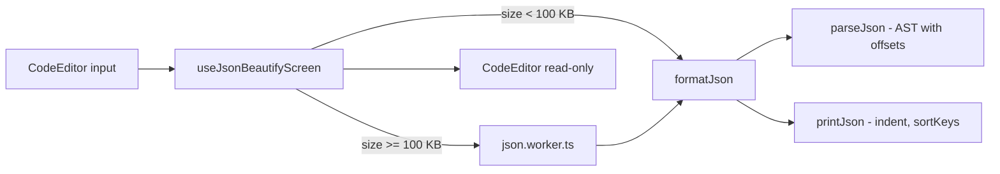

# JSON Tools Design

**Spec**: `.specs/features/json-tools/spec.md`
**Status**: Approved

## Architecture



## Components

### `features/json/lib/parseJson.ts`

- `parseJson(text): JsonParseResult`
  - `{ ok: true; value: JsonNode; warnings: JsonWarning[] }`
  - `{ ok: false; error: { message; offset; line; column } }`
- Recursive-descent parser. Numbers kept as their **raw source text** (JSON-06).
- Strips a leading BOM; leading/trailing whitespace ignored.
- Duplicate keys → `JsonWarning { message, offset, line, column }` (JSON-08).

### `features/json/lib/printJson.ts`

- `printJson(node, { indent: string; sortKeys: boolean }): string` — `indent === ''` = minify.

### `features/json/lib/formatJson.ts` / `summarizeJson.ts`

- `formatJson(text, options): FormatJsonResult` — parse + print.
- `summarizeJson(node, text)` → `{ rootType, childCount, sizeInBytes }` (JSON-04).

### Worker

- `features/json/json.worker.ts` → `exposeWorkerHandler(formatJson)`.

### Screens

- `JsonBeautifyScreen` + `useJsonBeautifyScreen`: indent select (2/4/tab), Minify toggle,
  Sort keys switch, stale output marker, loading indicator when in worker.
- `JsonValidationScreen` + `useJsonValidationScreen`: status + summary, duplicate warnings,
  lint diagnostics, "go to error" button calling `editorRef.focusAt(offset)`.

## Data Models

```ts
type JsonNode =
  | { kind: 'object'; entries: { key: string; rawKey: string; value: JsonNode }[] }
  | { kind: 'array'; items: JsonNode[] }
  | { kind: 'string'; raw: string }
  | { kind: 'number'; raw: string }
  | { kind: 'boolean'; value: boolean }
  | { kind: 'null' };
```

`raw` keeps the original escaped text so output preserves the input escapes exactly.
