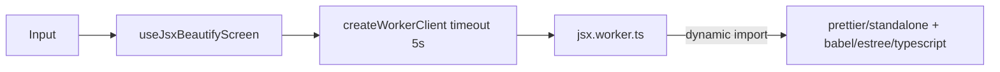

# JSX Beautify Design

**Spec**: `.specs/features/jsx-beautify/spec.md`
**Status**: Approved

## Architecture

## Components

- `features/jsx/lib/formatOptions.ts` — `JsxFormatOptions` + `defaultJsxFormatOptions`
  (Prettier defaults: printWidth 80, tabWidth 2, useTabs false, singleQuote false,
  jsxSingleQuote false, semi true, trailingComma 'all', bracketSameLine false, typescript false).
- `features/jsx/lib/formatJsx.ts` — `formatJsx(code, options): Promise<FormatJsxResult>`;
  loads Prettier lazily, maps `SyntaxError.loc` (1-based) to `{ message, line, column }`;
  `reasonCode === 'UnwrappedAdjacentJSXElements'` → friendly fragment message (JSX-03).
- `features/jsx/jsx.worker.ts` — `exposeWorkerHandler(formatJsx)`. Prettier only reachable from
  this worker, so it is never in the home bundle (JSX-04).
- `JsxBeautifyScreen` + `useJsxBeautifyScreen` — options toolbar, latest-wins via `useLatestTask`,
  stale marker, loading indicator during first load.

## Resilience (JSX-06)

`createWorkerClient` rejects after 5s, terminates the worker and creates a new one on next `run`.
