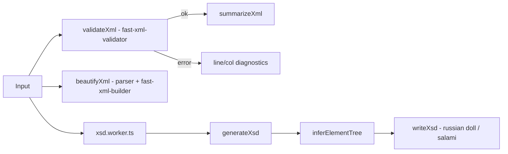

# XML Tools Design

**Spec**: `.specs/features/xml-tools/spec.md`
**Status**: Approved

## Architecture



## Components

- `features/xml/lib/xmlNodes.ts` — `parseOrderedXml(text)` (fast-xml-parser `preserveOrder`),
  helpers `getTagName(node)`, `getAttributes(node)`, `getChildren(node)`.
- `validateXml(text): XmlValidationResult` — `SyntaxValidator.validate` (throws `ValidationError`
  with `line`/`col`); adds a "multiple root elements" check the validator does not perform.
- `summarizeXml(text)` → `{ rootElement, elementCount, maxDepth, namespaces }` (XML-01).
- `beautifyXml(text, indent)` → preserves comments and CDATA via `commentPropName`/`cdataPropName` (XML-03).
- `inferElementTree(text)` → `ElementStats` tree keyed by path (occurrences, child cardinality,
  attribute samples, text samples, mixed flag).
- `inferSimpleType(samples)` → boolean → integer → decimal → date → dateTime → string (XSD-03).
- `writeXsd(tree, { style: 'russian-doll' | 'salami-slice', compositor: 'sequence' | 'all' })`
  - Salami slice merges stats by element name into global elements referenced with `ref`.
  - `xs:all` falls back to `xs:sequence` with a notice when any child repeats (XSD-08).
  - Root default namespace → `targetNamespace`, `xmlns`, `elementFormDefault="qualified"` (XSD-06).
  - Prefixed names → local name + notice (only default namespace mapped in v1).
- `generateXsd(text, options)` → `{ ok: true; xsd; notices } | { ok: false; error }`.
- `xsd.worker.ts` → `exposeWorkerHandler(generateXsd)` (XSD-01).

## Data Models

```ts
interface ElementStats {
  name: string;
  occurrences: number;
  textSamples: string[];
  hasMixedContent: boolean;
  attributes: Map<string, string[]>;      // attribute -> samples (length = presence count)
  children: Map<string, ChildStats>;      // insertion order = first appearance
}
interface ChildStats { element: ElementStats; parentsWithChild: number; maxPerParent: number }
```

`minOccurs="0"` when `parentsWithChild < parent.occurrences`; `maxOccurs="unbounded"` when
`maxPerParent > 1`; attribute `use="required"` when `samples.length === occurrences`.
