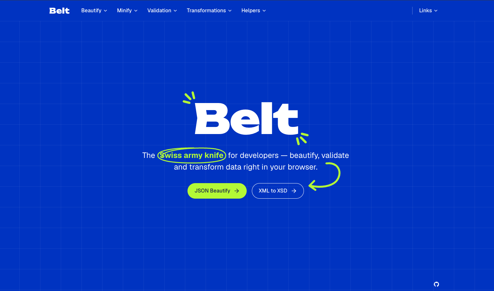
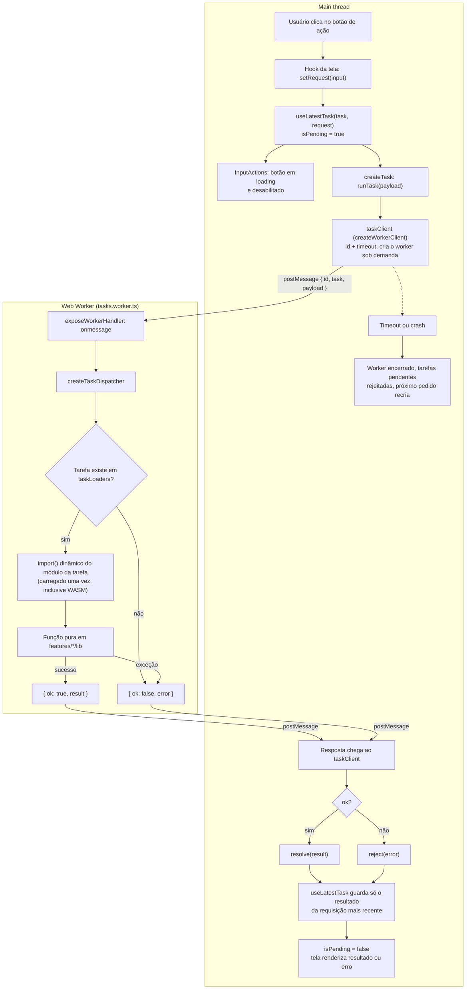

# Belt



O canivete suíço do desenvolvedor: uma caixa de ferramentas 100% client-side
que roda inteiramente no navegador. Nada do que você cola é armazenado ou
enviado para qualquer lugar.

## Ferramentas

| Grupo           | Ferramenta                | Rota                                   |
| --------------- | ------------------------- | -------------------------------------- |
| Beautify        | JSON Beautify             | `/beautify/json`                       |
| Beautify        | JSX Beautify (Prettier)   | `/beautify/jsx`                        |
| Beautify        | XML Beautify              | `/beautify/xml`                        |
| Minify          | JSON Minify               | `/minify/json`                         |
| Validation      | JSON Validation           | `/validation/json`                     |
| Validation      | XML Validation            | `/validation/xml`                      |
| Validation      | SQL Validation            | `/validation/sql`                      |
| Transformations | XML to XSD                | `/transformations/xml-to-xsd`          |
| Transformations | JSON to JSON Schema       | `/transformations/json-to-json-schema` |
| Transformations | SQL Aliases               | `/transformations/sql-aliases`         |
| Transformations | Base64                    | `/transformations/base64`              |
| Helpers         | Connection String Builder | `/helpers/connection-string`           |
| Helpers         | WSDL Inspector            | `/helpers/wsdl-inspector`              |
| Helpers         | JWT Decoder               | `/helpers/jwt-decoder`                 |

O header também tem links para [transform.tools](https://transform.tools),
[webhook.cool](https://webhook.cool) e
[4devs.com.br](https://www.4devs.com.br/). Cada ferramenta faz uma única coisa e
aponta para as ferramentas relacionadas (por exemplo, JSON Validation aponta
para JSON Beautify).

## Stack

Next.js 16 (App Router, static export), React 19, TypeScript, Chakra UI 3,
CodeMirror 6, um único Web Worker que executa o processamento de todas as
ferramentas (inclusive o parser de SQL em WASM), Vitest + Testing Library.

## Arquitetura de processamento

Toda ferramenta que processa algo ao clicar segue o mesmo caminho: a tela só
guarda a requisição e renderiza o resultado, e a lógica pura roda em um único
Web Worker, fora da main thread.



| Peça                                     | Responsabilidade                                        |
| ---------------------------------------- | ------------------------------------------------------- |
| Hook da tela (`features/*/use*Screen`)   | Guarda o input, dispara a tarefa e expõe `isRunning`    |
| `src/lib/useLatestTask.ts`               | Estado de pendência e descarte de resultados antigos    |
| `src/tasks/createTask.ts`                | Função tipada por tarefa sobre o client único           |
| `src/lib/worker/createWorkerClient.ts`   | Correlação por `id`, timeout e recriação do worker      |
| `src/tasks/tasks.worker.ts`              | Ponto de entrada do worker                              |
| `src/lib/worker/createTaskDispatcher.ts` | Resolve a tarefa, executa e devolve sucesso ou erro     |
| `src/tasks/taskLoaders.ts`               | Tabela de tarefas (`TaskMap`) com `import()` por tarefa |
| `features/*/lib`                         | Lógica pura, sem React, testável fora do navegador      |

As telas de SQL também pedem ao worker, ao abrir, para pré-carregar o parser em
WASM (`warmSqlParser`). Esse pedido roda em segundo plano, sem loading no botão;
se o usuário clicar antes de ele terminar, o botão mostra "Loading SQL parser…".

## Rodando localmente

Requer Node.js 24.

```bash
npm install
npm run dev          # http://localhost:3000
```

Para rodar o build de produção, exporte o site estático e sirva a pasta `out`
com qualquer servidor de arquivos estáticos:

```bash
npm run build
npx serve out
```

## Scripts

| Script              | Descrição                          |
| ------------------- | ---------------------------------- |
| `npm run dev`       | Servidor de desenvolvimento        |
| `npm run build`     | Static export para `out/`          |
| `npm run lint`      | ESLint                             |
| `npm run typecheck` | Geração de tipos das rotas + `tsc` |
| `npm test`          | Testes unitários e de componentes  |
| `npm run format`    | Prettier                           |

Os testes de XSD validam os schemas gerados com o `xmllint` quando ele está
instalado (já vem no macOS).

## Estrutura do projeto

```text
src/
  app/            rotas (páginas enxutas que renderizam a tela de uma feature)
  components/     UI compartilhada: navegação, editor, layout de ferramenta, campos de formulário
  features/       uma pasta por ferramenta: lib (lógica pura) e telas
  lib/            hooks compartilhados, client e dispatcher do Web Worker
  registry/       ferramentas, grupos e links externos (fonte única da verdade)
  tasks/          tabela de tarefas e o worker único que as executa
  theme/          system do Chakra: tokens e semantic tokens
```

Para adicionar uma ferramenta, crie a pasta da feature e a rota, depois adicione
uma entrada em `src/registry/tools.ts`; o menu a inclui automaticamente. Se ela
processa algo ao clicar, registre a função pura em `src/tasks/taskLoaders.ts` e
chame-a pela tela com `createTask`, para que rode no worker.
