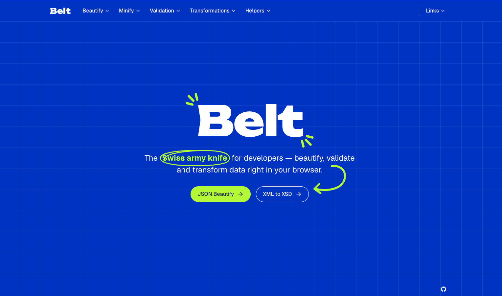

# Belt



O canivete suíço do desenvolvedor: uma caixa de ferramentas 100% client-side
que roda inteiramente no navegador. Nada do que você cola é armazenado ou
enviado para qualquer lugar.

## Ferramentas

| Grupo           | Ferramenta                | Rota                          |
| --------------- | ------------------------- | ----------------------------- |
| Beautify        | JSON Beautify             | `/beautify/json`              |
| Beautify        | JSX Beautify (Prettier)   | `/beautify/jsx`               |
| Beautify        | XML Beautify              | `/beautify/xml`               |
| Minify          | JSON Minify               | `/minify/json`                |
| Validation      | JSON Validation           | `/validation/json`            |
| Validation      | XML Validation            | `/validation/xml`             |
| Validation      | SQL Validation            | `/validation/sql`             |
| Transformations | XML to XSD                | `/transformations/xml-to-xsd` |
| Helpers         | Connection String Builder | `/helpers/connection-string`  |

O header também tem links para [transform.tools](https://transform.tools) e
[webhook.cool](https://webhook.cool). Cada ferramenta faz uma única coisa e
aponta para as ferramentas relacionadas (por exemplo, JSON Validation aponta
para JSON Beautify).

## Stack

Next.js 16 (App Router, static export), React 19, TypeScript, Chakra UI 3,
CodeMirror 6, Web Workers para processamento pesado, Vitest + Testing Library.

## Rodando localmente

Requer Node.js 24.

```bash
npm install
npm run dev          # http://localhost:3000
```

Para rodar o build de produção, exporte o site estático e sirva a pasta `out`
com qualquer servidor de arquivos estáticos:

```bash
npm run build
npx serve out
```

## Scripts

| Script              | Descrição                          |
| ------------------- | ---------------------------------- |
| `npm run dev`       | Servidor de desenvolvimento        |
| `npm run build`     | Static export para `out/`          |
| `npm run lint`      | ESLint                             |
| `npm run typecheck` | Geração de tipos das rotas + `tsc` |
| `npm test`          | Testes unitários e de componentes  |
| `npm run format`    | Prettier                           |

Os testes de XSD validam os schemas gerados com o `xmllint` quando ele está
instalado (já vem no macOS).

## Estrutura do projeto

```text
src/
  app/            rotas (páginas enxutas que renderizam a tela de uma feature)
  components/     UI compartilhada: navegação, editor, layout de ferramenta, campos de formulário
  features/       uma pasta por ferramenta: lib (lógica pura), workers, telas
  lib/            hooks compartilhados e o client de Web Worker
  registry/       ferramentas, grupos e links externos (fonte única da verdade)
  theme/          system do Chakra: tokens e semantic tokens
```

Para adicionar uma ferramenta, crie a pasta da feature e a rota, depois adicione
uma entrada em `src/registry/tools.ts`; o menu a inclui automaticamente.
